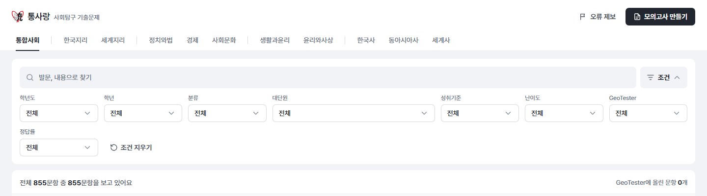

# 통사랑 (tongsarang)

사회탐구 기출문제를 과목, 시험, 단원별로 찾아보는 웹사이트입니다. 고등학교 사회과 선생님과 학생이 수능, 모의평가, 학력평가 문항을 빠르게 찾고, 골라서 모의고사 시험지로 묶을 수 있게 만들었습니다.

**바로 가기: [tongsarang.kr](https://tongsarang.kr)**



## 할 수 있는 일

- **문항 찾기**: 과목을 고르고 학년도, 학년, 시험, 대단원, 성취기준, 난이도, 정답률로 좁혀 봅니다. 발문과 문항 내용 글자로도 찾습니다. 조건은 고르는 즉시 반영됩니다.
- **문제 보기**: 표의 줄을 누르면 문항 그림을 크게 봅니다.
- **모의고사 만들기**: 원하는 문항을 골라 PDF 시험지로 내려받습니다. 과목을 바꿔도 고른 문항은 남아 있습니다. 같은 자료를 쓰는 묶음 문항을 함께 고르면 자료를 한 번만 넣고 `[a~b]` 머리말을 붙입니다. 문항 번호는 새 시험지 순서대로 다시 매깁니다.
- **GeoTester 바로가기**: 지리 문항 중 [GeoTester](https://geotester.bgnl.kr)에서 바꿔 풀 수 있는 문항은 표에서 바로 엽니다.
- **오류 신고**: 문항 정보가 틀렸으면 화면에서 바로 알릴 수 있습니다.
- **휴대폰과 태블릿**: 좁은 화면에서는 과목 목록이 햄버거 메뉴로, 조건 칸이 접히는 칸으로 바뀝니다.

## 담은 문항

2017학년도부터 2027학년도까지 수능, 6월과 9월 모의평가, 학력평가 문항 **14,435개**입니다(2026년 11월 기준).

| 묶음 | 과목 | 문항 수 |
|---|---|---:|
| 통합사회 | 통합사회 (고1, 고2) | 855 |
| 지리 | 한국지리 | 1,400 |
| | 세계지리 | 1,360 |
| 일반사회 | 경제 | 1,320 |
| | 정치와 법 | 1,320 |
| | 사회문화 | 1,320 |
| 윤리 | 생활과 윤리 | 1,360 |
| | 윤리와 사상 | 1,360 |
| 역사 | 한국사 | 1,380 |
| | 동아시아사 | 1,380 |
| | 세계사 | 1,380 |

시험 이름은 이렇게 적습니다.

- 수능과 모의평가는 **학년도**로 적습니다. 2026년 9월에 본 모의평가는 2027학년도입니다.
- 학력평가는 **시행 연도**로 적습니다.
- 시험 분류는 한국지리만 `6모`, `9모`, `3월학평`처럼 적고, 나머지 과목은 `6월`, `9월`, `3월`처럼 적습니다. 수능은 모두 `수능`입니다.
- 통합사회는 `학년` 칸으로 고1과 고2를 나눕니다. 고2 문항 그림은 과목 코드가 `iss2`입니다.

## 실행하기

```bash
npm install
npm run dev        # 개발 서버
npm run build      # dist/ 에 배포용 파일 만들기
npm run preview    # 빌드 결과 미리보기
```

배포는 `main` 브랜치에 push 하면 GitHub Actions(`.github/workflows/`)가 빌드해서 GitHub Pages로 올립니다. 도메인은 `public/CNAME`의 `tongsarang.kr`입니다.

화면만 확인하려고 열 때는 주소 끝에 `?noview=1`을 붙이면 방문자 수를 세지 않습니다.

## 새 시험 넣기

새 시험이 나오면 `scripts/`의 도구를 이 순서로 씁니다. 자세한 작업 기록은 `통사랑_작업기록.md`에 있습니다.

1. **시험지 받기와 자르기**: `python scripts/fetch_ebsi_2026.py --months 11 --only 한국지리,통합사회_고2 --quality 80`
   EBSi 시험지 목록에서 PDF를 받아 문항 그림으로 자르고 `public/images/`에 넣습니다. 로그인은 필요 없습니다. `--list`로 받을 수 있는 시험만 먼저 볼 수 있습니다.
2. **정답, 배점, 정답률 모으기**: `scripts/crawl_megastudy_2026.cjs`의 `G3_EXAMS`(고3) 또는 `ISS_EXAMS`(통합사회)에 메가스터디 시험 번호(`examSeq`)를 더하고 `node scripts/crawl_megastudy_2026.cjs`를 돌립니다. 이름이 아직 안 붙은 최신 시험은 EBSi 해설지 정답과 대조해 번호를 확정합니다. `--dry`로 결과만 볼 수 있습니다.
3. **글자 읽기(OCR)**: `node scripts/ocr_subjects.cjs 과목 학년도`로 발문과 문항 내용을 읽습니다(Tesseract 한국어 필요).
4. **번호 찌꺼기 지우기**: `node scripts/clean_ocr_prefix.cjs --exam 2027:수능`처럼 새로 읽은 시험만 지정합니다(`학년도:분류[:학년]`). 이미 정리한 시험에 다시 돌리면 정상 발문까지 깎일 수 있습니다.
5. **단원 나누기**: `node scripts/classify_chapters_2026.cjs`가 기존에 분류된 문항과 글이 닮은 정도로 대단원을 채우고, 확신이 낮은 문항은 검수 목록으로 보여 줍니다.
6. **점검**: `node scripts/verify_grade_column.mjs`. 통합사회 고1, 고2 문항 수가 이 파일에 적혀 있어서, 통합사회 시험을 더할 때마다 숫자를 올려야 합니다.
7. **묶음 문항 찾기**: `python scripts/detect_bundles.py --exam 2027_수능`처럼 새 시험만 돌립니다(통합사회 고2는 `2026_10월_고2`). `public/data/bundles.json`과 사람이 읽는 목록 [docs/묶음문항_목록.md](docs/묶음문항_목록.md)가 함께 바뀝니다. 전체를 다시 돌리면 10분 넘게 걸립니다.
8. **GeoTester 표시**: `python scripts/sync_geotester.py`. 옆 폴더 `../geotester-v2`의 문항 목록을 읽어 GeoTester 칸을 다시 채웁니다. GeoTester에 문항을 더했을 때도 돌립니다.
9. **눈으로 확인**: 평가원 시험은 오른쪽 단 맨 아래 문항(5, 10, 15번 부근) 그림에 시험지 아래쪽 안내 문구가 딸려 들어오지 않았는지 한 번 봅니다.

마지막으로 `public/data/`와 `public/images/`의 바뀐 파일을 커밋하고 push 합니다.

## 파일 구성

```
tongsarang/
├── index.html                화면 뼈대
├── src/
│   ├── main.js               시작점
│   ├── core/                 자료 불러오기, 필터, 단원 연결, 오류 신고, 방문자 수
│   ├── ui/                   화면 (표, 필터, 그림 창, 모의고사 만들기)
│   ├── styles/               화면 꾸밈 (tokens.css에 색과 크기)
│   └── data/                 성취기준 목록
├── public/
│   ├── data/                 과목별 문항 자료(과목.json), 묶음 문항(bundles.json)
│   ├── images/               문항 그림 (과목/학년도_월_코드_번호.jpg)
│   ├── fonts/                글꼴
│   └── CNAME                 tongsarang.kr
├── scripts/                  문항 모으기, 자르기, OCR, 단원 나누기, 묶음 찾기, 점검 도구
├── docs/                     묶음 문항 목록, 설계 문서, README 그림
├── .github/workflows/        GitHub Pages 배포
└── 통사랑_작업기록.md          작업 기록
```

루트의 `.ocr-*`, `.tesseract-*`, `.infer-std-*` 진행 파일과 `backup_images_한국지리/`, `temp_pdfs/`는 예전 작업 때 남은 중간 파일입니다.

## 기술

- [Vite](https://vitejs.dev)로 만든 정적 사이트, 프레임워크 없이 순수 JavaScript
- PDF 만들기: [jsPDF](https://github.com/parallax/jsPDF)
- 오류 신고와 방문자 수: Google Apps Script
- 자료 수집과 가공: Python, Node, Tesseract OCR

## 저작권

문항의 저작권은 출제 기관(한국교육과정평가원, 시도 교육청)에 있습니다. 이 사이트는 학생과 교사의 공부와 수업을 돕기 위해 문항을 찾기 쉽게 모아 둔 것이며, 상업적으로 쓰지 않습니다. 문항 그림은 EBSi에서 공개한 시험지에서, 정답률과 난이도는 메가스터디 공개 자료에서 가져왔습니다. 사이트의 코드는 만든 사람에게 저작권이 있습니다.

## 만든 사람

양정고등학교 지리교사 김용현  
문의: bgnlkim@gmail.com
